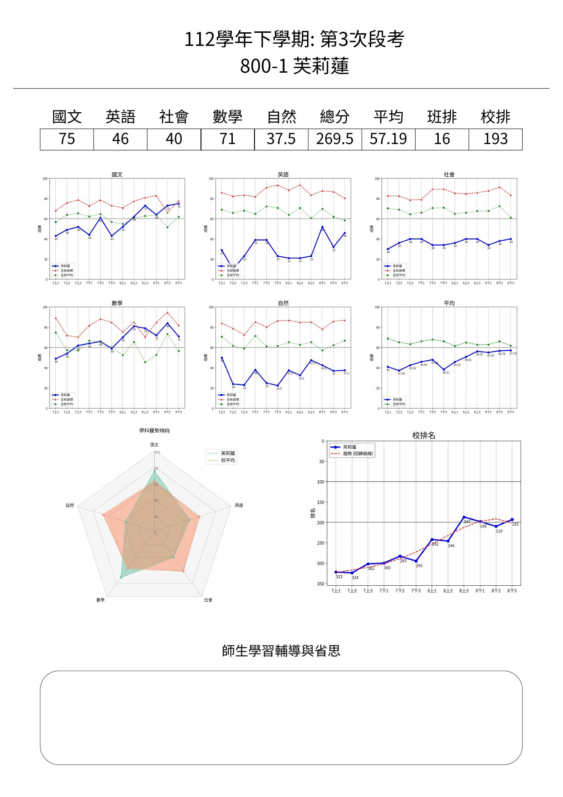

# 一鍵生成全班段考成績圖表

給國中導師的免費小工具：把全班歷次段考成績的 Excel 檔，一次轉成每位學生一頁的 PDF 成績分析報告。

不用安裝任何軟體，用瀏覽器打開 Google Colab 就能執行。

## 每位學生的報告包含

- 最近一次段考的各科成績、總分、平均、班排名、校排名
- 國文、英語、社會、數學、自然：歷次成績，對照全校平均與全校高標
- 五科平均：歷次成績，對照全校平均
- 校排名：歷次排名與趨勢線
- 雷達圖：最近一次段考的學科優勢傾向，對照全校平均
- 「師生學習輔導與省思」空白欄，可以列印後讓師生手寫

輸出檔案：每位學生一個 PDF、全班合併一個 PDF，以及每頁的 JPG 圖檔。

## 使用方法

1. 點上方的 **Open in Colab** 按鈕。
2. 先用範例資料試跑：選單 **執行階段 → 全部執行**（Runtime → Run all）。
3. 執行完成後，在左側「檔案」區的 `out_charts` 資料夾下載報告。
4. 換成自己的成績：
   1. 下載 [`template.xlsx`](template.xlsx)（空白範本），或參考 [`demo.xlsx`](demo.xlsx)（範例資料），填入全班成績。
   2. 把 Excel 檔上傳到 Colab 左側的「檔案」區。
   3. 把程式第 4 步的 `local_data_path` 改成你的檔名，再全部執行一次。

## Excel 檔格式

一個 Excel 檔、14 個工作表，順序要和範本相同：

| 工作表 | 內容 |
|---|---|
| 國、英、社、數、自 | 各科歷次段考成績：座號、學生，接著每次段考一欄（例如 7上1、7上2…） |
| 均 | 五科平均 |
| 班排、校排 | 歷次班排名、校排名 |
| 校均 | 歷次全校平均：學年、學期、段考、年級、班級、全校平均 |
| 國_校標 … 自_校標 | 各科歷次的全校平均、全校高標 |

段考次數不限：成績工作表每多一次段考就多一欄，校均和校標工作表就多一列，兩者的次數要一致。

## 常見問題

**成績資料會被上傳到哪裡？**
只會上傳到你自己的 Google Colab 執行環境，不會傳給作者或任何第三方。執行階段結束後，Colab 會清除這些檔案；下載完報告後，也可以直接刪除。

**全校人數不是 355 人怎麼辦？**
校排名圖預設全校 355 人，並在第 100、200 名畫分隔線。請在程式「副程式#3」裡修改 `plt.ylim(0,355)` 和兩條 `axhline` 的位置。

**需要會寫程式嗎？**
不需要。照著上面的步驟按「全部執行」即可；想客製化圖表的話，每個步驟都有中文註解。

## 更新紀錄

- **v2（2026-11）**：相容 pandas 3；中文字型改用免費開源的 Noto Sans TC；修正 PDF 版面標題重疊；範例資料改由 GitHub 下載。
- **v1（2024-10）**：首次發布。

## 授權

程式碼以 MIT 授權釋出，歡迎自由使用與修改。
